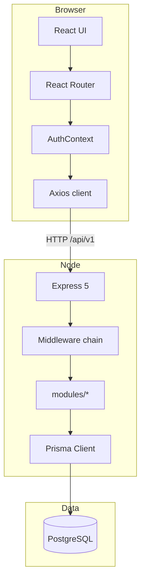

# Архитектура Flexora

## Обзор

Два отдельных пакета:

- **frontend/** — React SPA (Vite), прокси `/api` → `localhost:3001`
- **backend/** — REST API версии v1
- **Корень** — только `docker-compose.yml` и общий `.env` для Compose

## Backend (слои)

| Слой | Назначение |
|------|------------|
| `routes/v1` | Версионирование API, монтирование модулей |
| `modules/*` | feature-модули: `health`, `auth` |
| `*.controller.ts` | HTTP-адаптеры |
| `*.service.ts` | Бизнес-логика и Prisma |
| `*.schema.ts` | Zod-валидация |
| `middleware/` | auth, errors, logging, validate |
| `config/env.ts` | Типизированные env-переменные |

### Цепочка запроса

1. `helmet`, `cors`, `morgan`, `express.json`
2. Роут `/api/v1/*`
3. `validate` (Zod) при необходимости
4. `authenticate` / `authorize` для защищённых маршрутов
5. Controller → Service → Prisma
6. `errorHandler` — единый формат ошибок

## Аутентификация

1. **Register / Login** — bcrypt для паролей, JWT (`JWT_SECRET`, `JWT_EXPIRES_IN`).
2. Payload JWT: `sub`, `email`, `role`, `permissions`.
3. **GET /auth/me** — загрузка пользователя с ролью из БД.
4. **authorize(...)** — проверка permissions; `*` у ADMIN.

Запись в `ActivityLog` при регистрации, входе (LOGIN).

## Frontend

| Папка | Назначение |
|-------|------------|
| `pages/` | Login, Register, Dashboard |
| `layouts/` | `DashboardLayout` — оболочка с Sidebar |
| `components/` | Исходные виджеты dashboard + `ui/*` (shadcn-стиль) |
| `contexts/AuthContext` | Сессия, token в `localStorage` |
| `lib/api/client.ts` | Axios + interceptors |
| `services/` | Вызовы API |

Дизайн-система — токены в `frontend/src/index.css` (`@theme`): `brand`, `canvas`, `shell`, `surface`, `line`, `ink*`.

Dashboard (`DashboardPage`) **не перерисовывался**: используются те же компоненты `StatCards`, `RevenueChart`, и т.д.

## Что не входит в текущий этап

- CRUD сущностей (clients, projects, tasks)
- Загрузка файлов в хранилище
- Refresh tokens
- Полная навигация Sidebar по маршрутам

## OpenAPI

Спецификация: `http://localhost:3001/api/docs`  
JSON: `http://localhost:3001/api/docs.json`
