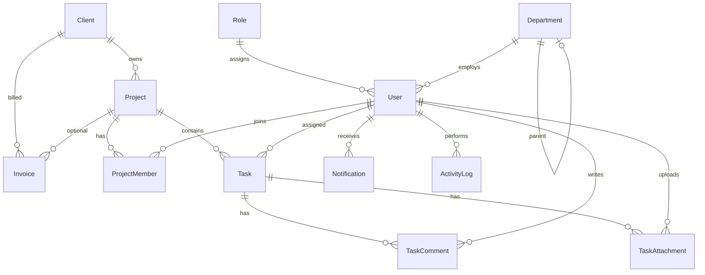

# Схема базы данных Flexora

PostgreSQL, ORM: Prisma. Все первичные ключи — UUID.

## ER-диаграмма



## Перечисления (enums)

| Enum | Значения |
|------|----------|
| ProjectStatus | PLANNING, ACTIVE, ON_HOLD, COMPLETED, CANCELLED |
| TaskStatus | TODO, IN_PROGRESS, REVIEW, DONE, CANCELLED |
| TaskPriority | LOW, MEDIUM, HIGH, URGENT |
| InvoiceStatus | DRAFT, SENT, PAID, OVERDUE, CANCELLED |
| ClientStatus | LEAD, ACTIVE, INACTIVE, CHURNED |
| ProjectMemberRole | OWNER, MANAGER, MEMBER, VIEWER |
| NotificationType | INFO, TASK, PROJECT, INVOICE, SYSTEM |
| ActivityAction | CREATE, UPDATE, DELETE, LOGIN, LOGOUT, ASSIGN, COMMENT |

## Таблицы

### Role

Роли и RBAC. Поле `permissions` — JSON-массив строк; `*` — полный доступ.

### Department

Отделы компании. `parentId` — иерархия подразделений.

### User

Сотрудники и пользователи системы. Уникальный `email`. `passwordHash` — только bcrypt-хэш.

### Client

Клиенты IT-компании.

### Project

Проекты, привязаны к `Client`. `budget` — `Decimal(14,2)`.

### ProjectMember

Связь many-to-many User ↔ Project. Уникальность `(projectId, userId)`.

### Task

Задачи внутри проекта. Опциональный `assigneeId`.

### TaskComment

Комментарии к задачам.

### TaskAttachment

Метаданные вложений (`storageKey` для будущего хранилища файлов).

### Invoice

Счета. Уникальный `invoiceNumber`. Опциональная привязка к проекту.

### Notification

Уведомления пользователя. `readAt` — метка прочтения.

### ActivityLog

Журнал действий (аудит). `metadata` — произвольный JSON.

## Индексы

- `User`: `departmentId`, `roleId`
- `Client`: `status`, `email`
- `Project`: `(clientId, status)`
- `ProjectMember`: `userId`, unique `(projectId, userId)`
- `Task`: `(projectId, status)`, `assigneeId`
- `TaskComment`: `taskId`
- `TaskAttachment`: `taskId`
- `Invoice`: `(clientId, status)`, `projectId`
- `Notification`: `(userId, readAt)`
- `ActivityLog`: `createdAt`, `(entityType, entityId)`, `userId`

## Миграции

```bash
cd backend
npx prisma migrate dev
npx prisma db seed
```

Исходная схема: `backend/prisma/schema.prisma`.
