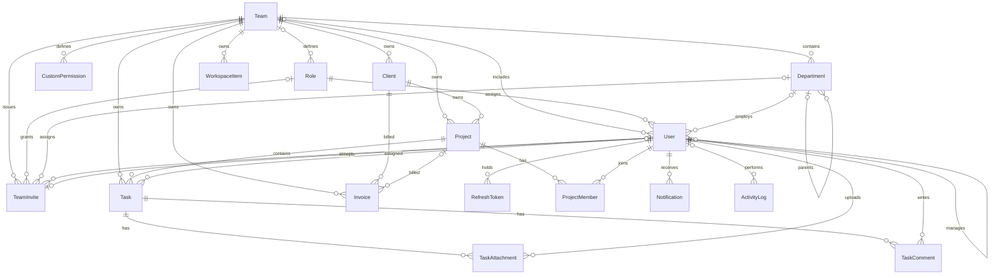

# Схема базы данных Flexora

PostgreSQL, ORM: Prisma. Все первичные ключи — UUID.

После применения восьми миграций в схеме `public` есть 17 таблиц приложения и служебная таблица `_prisma_migrations`. Для проверки количества подключитесь к базе Flexora и выполните запрос.

```sql
SELECT count(*) AS application_tables
FROM information_schema.tables
WHERE table_schema = 'public'
  AND table_type = 'BASE TABLE'
  AND table_name <> '_prisma_migrations';
```

## ER-диаграмма



## Перечисления (enums)

| Enum | Значения |
|------|----------|
| ProjectStatus | PLANNING, ACTIVE, ON_HOLD, COMPLETED, CANCELLED |
| TaskStatus | TODO, IN_PROGRESS, REVIEW, DONE, CANCELLED |
| TaskPriority | LOW, MEDIUM, HIGH, URGENT |
| InvoiceStatus | DRAFT, SENT, PAID, OVERDUE, CANCELLED |
| ClientStatus | LEAD, ACTIVE, INACTIVE, CHURNED |
| ProjectMemberRole | OWNER, MANAGER, MEMBER, VIEWER |
| NotificationType | INFO, TASK, PROJECT, INVOICE, SYSTEM |
| ActivityAction | CREATE, UPDATE, DELETE, LOGIN, LOGOUT, ASSIGN, COMMENT |

## Таблицы

### Team

Рабочее пространство компании. Личный аккаунт получает `teamId` после вступления в команду.

### Role

Роли и RBAC. Поле `permissions` — JSON-массив строк; `*` — полный доступ.

### CustomPermission

Дополнительные разрешения команды. Код `slug` уникален в пределах команды.

### Department

Отделы компании. `parentId` — иерархия подразделений.

### User

Сотрудники и пользователи системы. Уникальный `email`. `passwordHash` — только bcrypt-хэш.

### TeamInvite

Приглашения в команду с ролью, сроком действия и статусом принятия. Для ссылок и кодов хранятся хэши.

### RefreshToken

Хэши токенов обновления сессии, срок действия и время отзыва.

### Client

Клиенты IT-компании.

### Project

Проекты, привязанные к `Client`. В текущем интерфейсе эта модель обслуживает «Сделки» и «Воронку». Тип поля `budget` — `Decimal(14,2)`.

### ProjectMember

Связь many-to-many User ↔ Project. Уникальность `(projectId, userId)`.

### Task

Задачи внутри проекта. Опциональный `assigneeId`.

### TaskComment

Комментарии к задачам.

### TaskAttachment

Метаданные вложений (`storageKey` для будущего хранилища файлов).

### Invoice

Счета. `invoiceNumber` уникален в пределах команды. `paidAt` хранит время оплаты. Привязка к проекту необязательна.

### Notification

Уведомления пользователя. `readAt` — метка прочтения.

### ActivityLog

Журнал действий (аудит). `metadata` — произвольный JSON.

### WorkspaceItem

Записи кампаний, черновиков email, правил автоматизации и обратной связи. `kind` задаёт тип, `runs` учитывает запуски правила.

## Индексы

- `User`: `departmentId`, `roleId`
- `Client`: `status`, `email`
- `Project`: `(clientId, status)`
- `ProjectMember`: `userId`, unique `(projectId, userId)`
- `Task`: `(projectId, status)`, `assigneeId`
- `TaskComment`: `taskId`
- `TaskAttachment`: `taskId`
- `Invoice`: `(clientId, status)`, `projectId`
- `Notification`: `(userId, readAt)`
- `ActivityLog`: `createdAt`, `(entityType, entityId)`, `userId`
- Таблицы со ссылкой на `Team` индексируют `teamId`. Уникальность в команде задана для `Role.name`, `Department.name`, `CustomPermission.slug` и `Invoice.invoiceNumber`.

## Миграции

```bash
cd backend
npm run db:deploy
npm run db:seed
```

Исходная схема: `backend/prisma/schema.prisma`.
